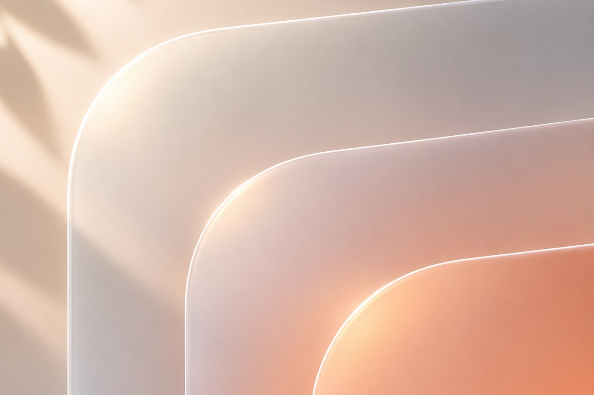
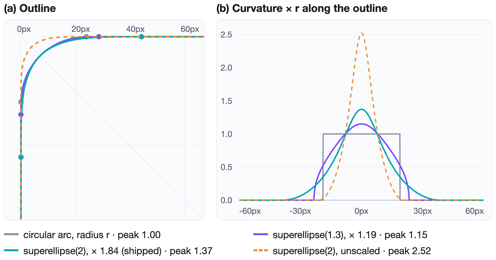
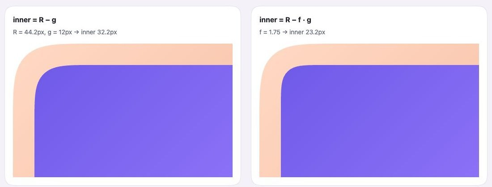
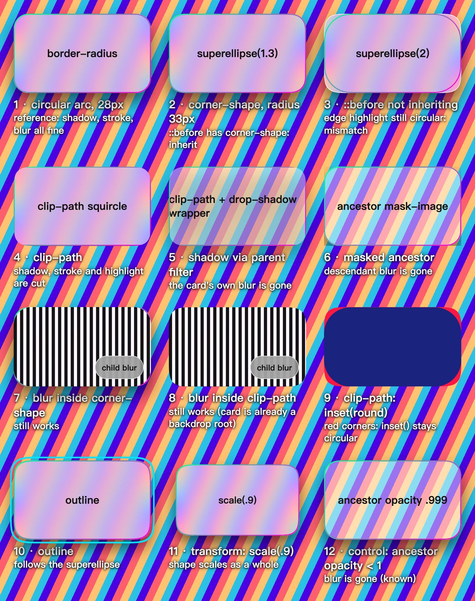
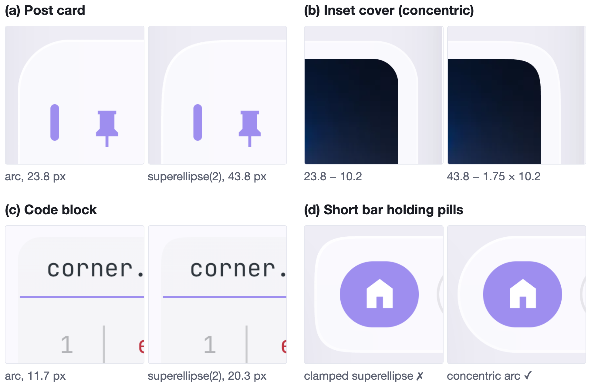
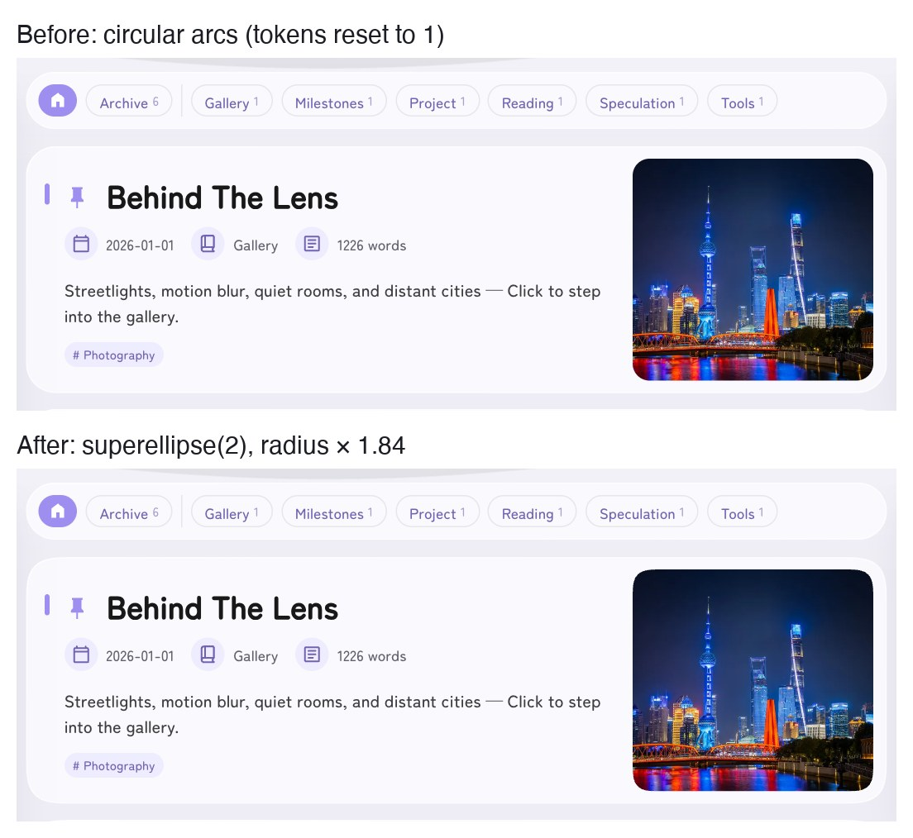

# CSS Continuous Corners

Curvature-continuous rounded corners for the web, built on `corner-shape: superellipse()`.
This is the corner system of [the AshZluX blog](https://blog.seraphic.top), packaged so you can reuse it.

**Read the paper: [Continuous Corners in CSS](https://blog.seraphic.top/posts/continuous-corners/)**. It covers the geometry, why `clip-path` and `mask` break glass UI, concentric offsets, and what a site-wide rollout measured.



## Why

A corner drawn with `border-radius` joins a straight edge to a quarter circle. Direction is continuous there, but curvature is not: it jumps from 0 on the edge to 1/r on the arc. On large, outlined, glassy surfaces the eye reads that jump as a faint kink.

A superellipse corner, $|x|^n + |y|^n = 1$ with $n = 2^k$ and $k > 1$, starts its curvature at 0 and lets it rise smoothly. CSS draws one with `corner-shape: superellipse(k)`.



The grey box on the right is the circle's curvature; the teal bell is the shipped `superellipse(2)` with its radius scaled by 1.84. The dashed orange line is the common mistake of switching the shape without scaling the radius: the corner gets *sharper*.

## See it

- **On the blog.** [blog.seraphic.top](https://blog.seraphic.top) uses this system for every card, panel, cover image and code block. Open it in Chrome or Edge 139+.
- **In the demo.** [`demo/index.html`](demo/index.html) is a dark showcase drawn by the real CSS in this repo: a glass card with an inset cover, nested concentric frames, side-by-side tiles, an outline overlay and the curvature profile. One switch flips every shape between `border-radius` and `corner-shape`. It needs no build step and works straight from `file://`:

  ```bash
  git clone https://github.com/SeraphicQAQ/css-continuous-corners.git
  open css-continuous-corners/demo/index.html   # in Chrome or Edge 139+
  ```


## What's inside

| Path | What it is |
| --- | --- |
| [`css/continuous-corners.css`](css/continuous-corners.css) | Drop-in CSS: three tokens, presets and utility classes |
| [`css/continuous-corners.tailwind.css`](css/continuous-corners.tailwind.css) | The same for Tailwind CSS v4, as `@utility` classes |
| [`js/circular-radius.js`](js/circular-radius.js) | The circle that matches a superellipse corner, for `clip-path: inset(round)` transitions |
| [`demo/index.html`](demo/index.html) | A dark showcase of the corners, drawn by the CSS above |
| [`tools/geometry.mjs`](tools/geometry.mjs) | Reproduces every number in this README |
| [`docs/images/`](docs/images) | Figures from the paper and the demo |

## Quick start

Plain CSS:

```html
<link rel="stylesheet" href="css/continuous-corners.css">

<article class="card rounded-surface" style="padding: 12px">
  
  …
</article>
```

Tailwind CSS v4:

```css
@import "tailwindcss";
@import "./continuous-corners.tailwind.css";
```

```html
<article class="rounded-surface p-3">
  
</article>
```

| Class | Use it for |
| --- | --- |
| `rounded-surface` | Cards, panels, dialogs, page containers, article images |
| `rounded-surface-medium` | Photos and tiles inside a card |
| `rounded-block` | Code blocks and other small blocks |
| `rounded-concentric` (`--inset`) / `rounded-concentric-N` | Anything inset from a surface's corner |
| `rounded-inherit` | Overlays, hover layers and highlight rings that follow their parent |

Buttons, tags, pills and circular avatars should keep plain `border-radius` (see [Pitfalls](#pitfalls)).

Browsers without `corner-shape` skip the `@supports` block. They render the original circular design at its original radii, so nothing degrades. At the time of writing, Chrome and Edge 139+ draw the new corners; Safari and Firefox fall back.

## The three rules

**1. Scale the radius with the shape.** A superellipse hugs its corner more tightly than a circle with the same radius. To keep each corner the same size, match the depth along the 45° diagonal:

$$s(k) = \frac{R}{r} = \frac{1 - 2^{-1/2}}{1 - 2^{-1/n}}, \qquad n = 2^k$$

**2. Scale the concentric rule.** For circles, an element inset by a gap $g$ uses the inner radius $R - g$, and the gap around the corner stays even. The inward offset of a superellipse is not a superellipse, so with the same rule the corner gap grows too thick. Use $R - f(k) \cdot g$ instead.



**3. Never set the shape on its own.** A larger radius with a circular shape looks too round, and a superellipse with the old radius looks too sharp. That is why the classes always set both, and why the presets change all three tokens together:

| Preset (`data-corners`) | Shape | Radius × | Concentric factor | Max. outline change | ≈ Figma corner smoothing |
| --- | --- | --- | --- | --- | --- |
| `round` | `superellipse(1)` | 1.00 | 1.00 | — | 0 % |
| `ios` | `superellipse(1.3)` | 1.19 | 1.17 | 0.28 px | 60 % ("iOS") |
| `soft` | `superellipse(1.6)` | 1.43 | 1.39 | 0.48 px | — |
| `strong` (default) | `superellipse(2)` | 1.84 | 1.75 | 0.68 px | 100 % |

These values are measured for a 23.8 px radius and a 10.2 px gap. With the factor, the corner gap stays within 0.25 px of the edge gap; with the plain $R - g$ it is off by up to 1.9 px. Put `data-corners="ios"` on any element to try another preset for that part of the page.

## Pitfalls

**Don't cut the shape with `clip-path` or `mask` on glass UI.** Both clip away shadows and outlines. The usual fix, a `filter: drop-shadow()` on a wrapper, turns the wrapper into a *backdrop root*, and the card's own `backdrop-filter` stops blurring (cell 5). A mask on any ancestor removes every blur inside it (cell 6). `corner-shape` has none of these problems.



- **Pseudo-element rings.** If you draw a stroke or highlight with `::before { border-radius: inherit }`, add `corner-shape: inherit` as well. Otherwise the ring stays circular and drifts away from its host at the corner (cell 3).
- **`clip-path: inset(… round r)` is always circular** (cell 9). Shared-element transitions that clip a moving copy that way should use `circularRadius(element)` from `js/circular-radius.js`. It gives the circle with the same diagonal depth, so the corner doesn't jump at either end.
- **Small controls.** On a short element the browser clamps the scaled radius to half the height, and a clamped superellipse turns a capsule into something like an app icon. Keep buttons, tags and pills round.
- **Short containers that hold pills.** A bar shorter than about twice the surface radius gets its radius clamped too, and its squarer ends make the corner gap wider than the edges. Make it concentric with its pills instead: pill radius plus padding, with `corner-shape: round`.

## Results on the blog





A headless audit of all 21 pages at desktop and phone widths found about 100 element types (roughly 2,000 rendered instances) using the superellipse. None of them had an unscaled radius, and no pseudo-element disagreed with its host. Scrolling 40 glass cards under 4× CPU throttling held 60 fps with circles and with superellipses alike.

## Tools

```bash
node tools/geometry.mjs                    # scale, outline change, peak curvature, concentric factor
node tools/geometry.mjs --r=16 --gap=8     # for your own radius and gap
node tools/geometry.mjs --k=2 --figma      # also match Figma's corner smoothing (a few seconds)
```

Requires Node 18 or later; no dependencies.

## Read more

The full write-up, with the derivations, the alternatives that were tried and the regressions the rollout caught, is **[Continuous Corners in CSS](https://blog.seraphic.top/posts/continuous-corners/)** on the blog.

References: [CSS Borders Level 4](https://drafts.csswg.org/css-borders-4/) · [The corner cases of implementing CSS corner-shape in Blink](https://developer.chrome.com/blog/implementing-corner-shape) · [MDN: corner-shape](https://developer.mozilla.org/en-US/docs/Web/CSS/corner-shape) · [Filter Effects Level 2 (backdrop root)](https://drafts.fxtf.org/filter-effects-2/) · [figma-squircle](https://github.com/phamfoo/figma-squircle) · [Desperately seeking squircles](https://www.figma.com/blog/desperately-seeking-squircles/)

## License

- Code (`css/`, `js/`, `tools/`, `demo/`): [MIT](LICENSE).
- Text and images (this README and `docs/`): [CC BY-NC-SA 4.0](LICENSE-docs.md), the same license as the blog post.
