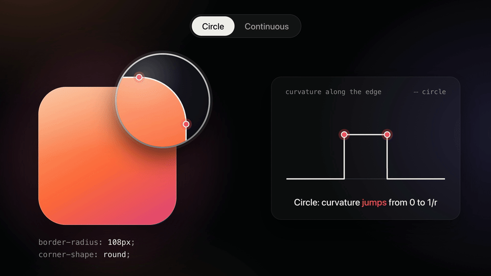
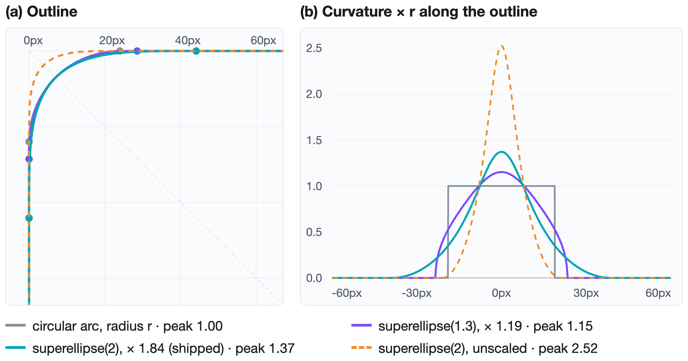
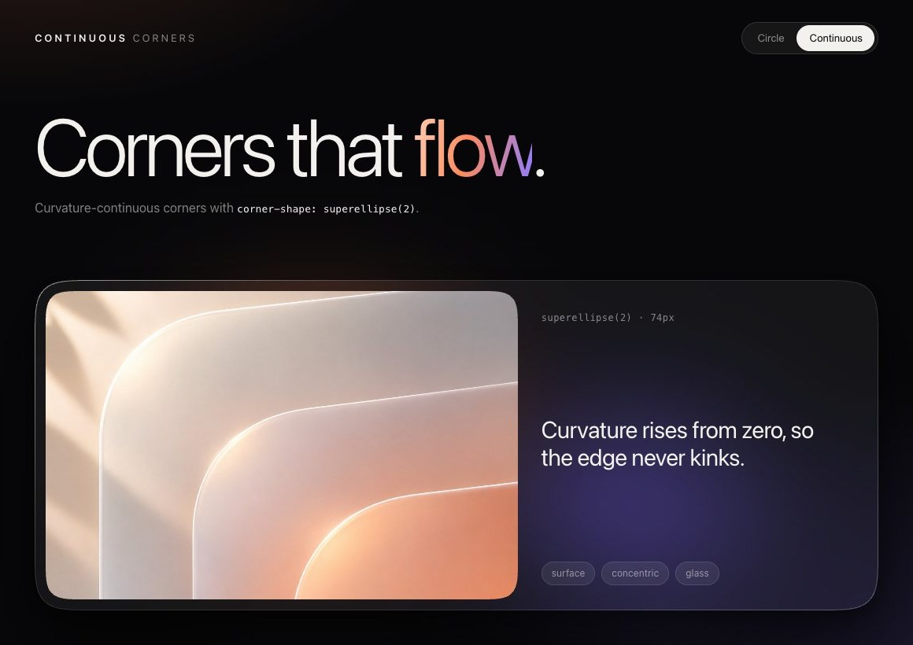
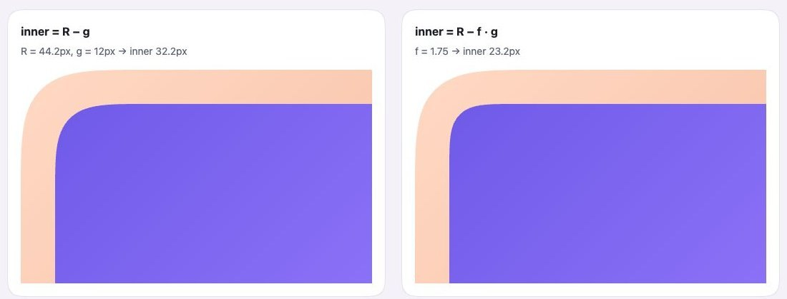
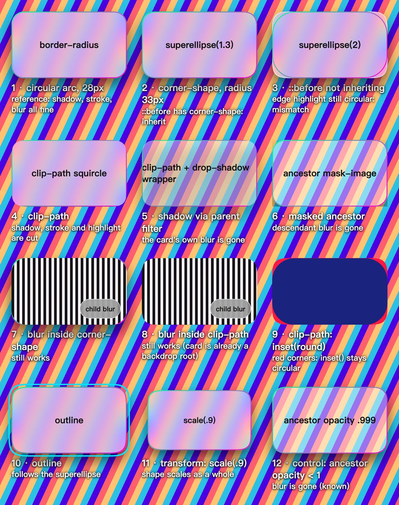
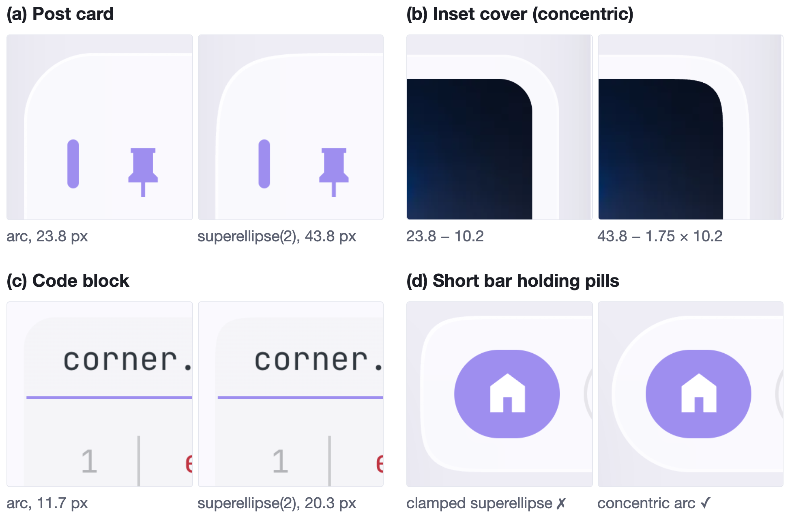
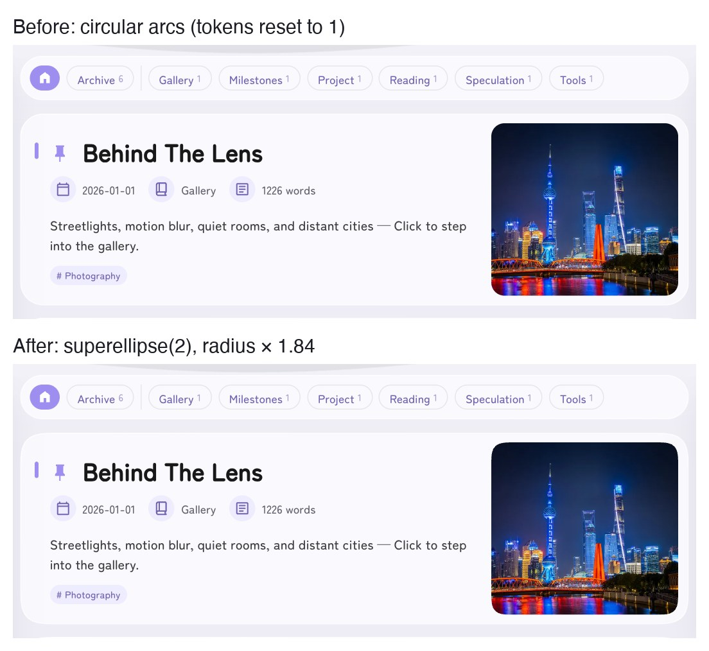

# CSS Continuous Corners

[English](README.md) | **简体中文**

基于 `corner-shape: superellipse()` 的网页连续曲率圆角。这是 [AshZluX 博客](https://blog.seraphic.top)使用的圆角系统，整理打包后方便你直接复用。

**[在线演示](https://seraphicqaq.github.io/css-continuous-corners/demo/)**（需 Chrome 或 Edge 139+）· **[阅读论文](https://blog.seraphic.top/posts/continuous-corners/)**（英文）



**一句话总结：** `corner-shape: superellipse(2)` 能画出这种形状，但如果只加这一行，转角反而会变得*更尖*，嵌套元素的间距也会不均匀。这个仓库补上了缺少的部分：

- **半径 × 1.84**，让每个转角保持原来的视觉大小（[规则 1](#三条规则)）
- **同心系数**，让内嵌元素的间距保持均匀：误差在 0.25 px 以内，而直接用 `R − g` 会差 1.9 px（[规则 2](#三条规则)）
- **一份踩坑清单**，来自全站实际铺开的经验：毛玻璃界面、伪元素描边、`clip-path` 过渡和小控件（[常见陷阱](#常见陷阱)）

论文 [Continuous Corners in CSS](https://blog.seraphic.top/posts/continuous-corners/)（英文）讲解了几何原理、为什么 `clip-path` 和 `mask` 会破坏毛玻璃界面、同心偏移，以及全站铺开后的实测数据。

## 为什么

用 `border-radius` 画出的转角，是一段直线接上四分之一圆弧。在接缝处，方向是连续的，曲率却不是：它从直边上的 0 突然跳到圆弧上的 1/r。在尺寸较大、带描边、有玻璃质感的界面上，人眼会把这个跳变看成一处轻微的“折痕”。

超椭圆转角 $|x|^n + |y|^n = 1$（其中 $n = 2^k$，$k > 1$）的曲率从 0 开始，平滑地上升。CSS 用 `corner-shape: superellipse(k)` 就能画出它。



右侧的灰色方框是圆角的曲率；青色的钟形曲线是实际采用的 `superellipse(2)`，半径放大了 1.84 倍。橙色虚线是常见的错误做法：只换形状、不放大半径，结果转角变得*更尖*。

## 效果展示

- **在博客上看。** [blog.seraphic.top](https://blog.seraphic.top) 的所有卡片、面板、封面图和代码块都用了这套系统。请用 Chrome 或 Edge 139 及以上版本打开。
- **看演示页。** [`demo/index.html`](demo/index.html) 是一个深色展示页，完全由本仓库的 CSS 绘制：一张带内嵌封面的玻璃卡片、多层同心嵌套的边框、并排的色块、轮廓叠加对比，以及曲率曲线。一个开关就能让所有形状在 `border-radius` 和 `corner-shape` 之间切换。可以[在线打开](https://seraphicqaq.github.io/css-continuous-corners/demo/)，也可以在本地运行，无需构建，直接用 `file://` 打开即可：

  ```bash
  git clone https://github.com/SeraphicQAQ/css-continuous-corners.git
  open css-continuous-corners/demo/index.html   # 用 Chrome 或 Edge 139+ 打开
  ```



## 仓库内容

| 路径 | 说明 |
| --- | --- |
| [`css/continuous-corners.css`](css/continuous-corners.css) | 直接引入即可使用的 CSS：三个设计变量、预设和工具类 |
| [`css/continuous-corners.tailwind.css`](css/continuous-corners.tailwind.css) | 同样的内容，Tailwind CSS v4 版本，以 `@utility` 类提供 |
| [`js/circular-radius.js`](js/circular-radius.js) | 计算与超椭圆转角相匹配的圆，用于 `clip-path: inset(round)` 过渡动画 |
| [`demo/index.html`](demo/index.html) | 圆角的深色展示页，由上面的 CSS 绘制 |
| [`tools/geometry.mjs`](tools/geometry.mjs) | 复现 README 中的所有数字 |
| [`docs/images/`](docs/images) | 论文和演示页中的配图 |

## 快速上手

原生 CSS：

```html
<link rel="stylesheet" href="css/continuous-corners.css">

<article class="card rounded-surface" style="padding: 12px">
  
  …
</article>
```

Tailwind CSS v4：

```css
@import "tailwindcss";
@import "./continuous-corners.tailwind.css";
```

```html
<article class="rounded-surface p-3">
  
</article>
```

| 类名 | 适用于 |
| --- | --- |
| `rounded-surface` | 卡片、面板、对话框、页面容器、文章配图 |
| `rounded-surface-medium` | 卡片内的照片和色块 |
| `rounded-block` | 代码块等小型区块 |
| `rounded-concentric`（`--inset`）/ `rounded-concentric-N` | 从某个表面的转角向内缩进的任何元素 |
| `rounded-inherit` | 跟随父元素形状的遮罩层、悬停层和高亮描边 |

按钮、标签、胶囊和圆形头像应保持普通的 `border-radius`（见[常见陷阱](#常见陷阱)）。

不支持 `corner-shape` 的浏览器会跳过 `@supports` 代码块，按原来的半径显示原来的圆角设计，所以不会有任何退化。截至撰写时，Chrome 和 Edge 139+ 会绘制新的转角；Safari 和 Firefox 会回退到普通圆角。

## 三条规则

**1. 换形状时同时放大半径。** 半径相同时，超椭圆比圆弧更贴近转角。要让每个转角保持同样的大小，就要让两者在 45° 对角线方向上的深度相等：

$$s(k) = \frac{R}{r} = \frac{1 - 2^{-1/2}}{1 - 2^{-1/n}}, \qquad n = 2^k$$

**2. 同心规则也要缩放。** 对于圆角，一个向内缩进间距 $g$ 的元素使用内半径 $R - g$，转角处的间距就能保持均匀。但超椭圆向内偏移后不再是超椭圆，沿用同样的规则，转角处的间距会变得过厚。应改用 $R - f(k) \cdot g$。



**3. 永远不要只改形状。** 半径放大了但形状还是圆弧，看起来太圆；换成超椭圆却沿用旧半径，看起来又太尖。所以工具类总是同时设置两者，预设也总是同时修改三个变量：

| 预设（`data-corners`） | 形状 | 半径倍数 | 同心系数 | 轮廓最大变化 | ≈ Figma 圆角平滑度 |
| --- | --- | --- | --- | --- | --- |
| `round` | `superellipse(1)` | 1.00 | 1.00 | — | 0 % |
| `ios` | `superellipse(1.3)` | 1.19 | 1.17 | 0.28 px | 60 %（“iOS”） |
| `soft` | `superellipse(1.6)` | 1.43 | 1.39 | 0.48 px | — |
| `strong`（默认） | `superellipse(2)` | 1.84 | 1.75 | 0.68 px | 100 % |

以上数值是在半径 23.8 px、间距 10.2 px 的条件下测得的。使用同心系数后，转角处的间距与直边处的间距相差不超过 0.25 px；直接用 $R - g$ 则最多相差 1.9 px。在任意元素上加 `data-corners="ios"`，就能让页面的这一部分试用另一套预设。

## 常见陷阱

**不要在毛玻璃界面上用 `clip-path` 或 `mask` 裁出形状。** 两者都会把阴影和描边一起裁掉。常见的补救办法是在外层包裹元素上加 `filter: drop-shadow()`，但这会让包裹元素变成一个 *backdrop root*（背景根），卡片自身的 `backdrop-filter` 就不再模糊了（第 5 格）。任何祖先元素上的 mask 都会让其内部的所有模糊失效（第 6 格）。`corner-shape` 没有这些问题。



- **伪元素描边。** 如果你用 `::before { border-radius: inherit }` 画描边或高光，还要加上 `corner-shape: inherit`。否则描边仍然是圆弧，在转角处会和宿主元素错开（第 3 格）。
- **`clip-path: inset(… round r)` 永远是圆弧**（第 9 格）。用这种方式裁剪移动副本的共享元素过渡，应改用 `js/circular-radius.js` 中的 `circularRadius(element)`。它给出对角线深度相同的圆，这样过渡开始和结束时转角都不会跳变。
- **小控件。** 在较矮的元素上，浏览器会把放大后的半径钳制为高度的一半，被钳制的超椭圆会把胶囊形状变得像 App 图标。按钮、标签和胶囊请保持圆角。
- **装着胶囊的矮容器。** 高度不到表面半径两倍左右的条状容器，半径同样会被钳制，它两端更方的形状会让转角处的间距比直边处更宽。应让它与内部的胶囊同心：胶囊半径加上内边距，并使用 `corner-shape: round`。

## 博客上的实测结果





用无头浏览器在桌面和手机两种宽度下审查了全部 21 个页面，共发现约 100 种元素（约 2000 个渲染实例）使用了超椭圆。其中没有一个漏掉半径放大，也没有一个伪元素与宿主元素的形状不一致。在 4 倍 CPU 降速下滚动 40 张玻璃卡片，圆角和超椭圆都稳定在 60 fps。

## 工具

```bash
node tools/geometry.mjs                    # 缩放比例、轮廓变化、曲率峰值、同心系数
node tools/geometry.mjs --r=16 --gap=8     # 代入你自己的半径和间距
node tools/geometry.mjs --k=2 --figma      # 同时匹配 Figma 的圆角平滑度（需要几秒）
```

需要 Node 18 或更高版本，无任何依赖。

## 延伸阅读

完整的论文包括推导过程、尝试过的其他方案，以及铺开过程中发现的回归问题，见博客上的 **[Continuous Corners in CSS](https://blog.seraphic.top/posts/continuous-corners/)**（英文）。

参考资料：[CSS Borders Level 4](https://drafts.csswg.org/css-borders-4/) · [The corner cases of implementing CSS corner-shape in Blink](https://developer.chrome.com/blog/implementing-corner-shape) · [MDN: corner-shape](https://developer.mozilla.org/en-US/docs/Web/CSS/corner-shape) · [Filter Effects Level 2 (backdrop root)](https://drafts.fxtf.org/filter-effects-2/) · [figma-squircle](https://github.com/phamfoo/figma-squircle) · [Desperately seeking squircles](https://www.figma.com/blog/desperately-seeking-squircles/)

## 许可

- 代码（`css/`、`js/`、`tools/`、`demo/`）：[MIT](LICENSE)。
- 文字和图片（README 的英文版与中文版，以及 `docs/`）：[CC BY-NC-SA 4.0](LICENSE-docs.md)，与博客文章的许可相同。
